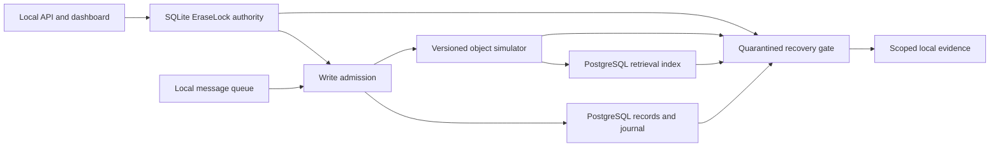

# RewindGuard X local evaluation

Updated 19 October 2026. This report records an actual offline run and its limits. Generate machine-readable per-run evidence with `python -m lab.cli --output lab/reports/local-suite.json suite --seeds 42 43`. The output is ignored by Git because run IDs and timestamps vary.

## Design and measured result

The suite pairs a naive baseline and EraseLock treatment for four scenarios: old PostgreSQL recovery, delayed message, older S3-like object version, and search-index re-ingestion. Each scenario has one synthetic forbidden attempt per seed. The oracle reads the backing PostgreSQL tables or object-version store directly; it does not trust a workflow's PASS label.

| Metric | Baseline | Protected |
| --- | ---: | ---: |
| Seeds | 42, 43 | 42, 43 |
| Scenario runs | 8 | 8 |
| Forbidden attempts | 8 | 8 |
| Forbidden exposures observed by the local oracle | 8 | 0 |

Observed suite result: `PASS`; all eight pairs improved and all protected attempts were prevented. The test command `RGX_TEST_POSTGRES_DSN='postgresql://shaurya@127.0.0.1:55432/postgres' .venv/bin/python -m pytest -q` passed 49 tests with one third-party deprecation warning. This DSN is this machine's local PostgreSQL endpoint; use the README's Docker DSN elsewhere.

The lab's `evidence_decision` describes the erasure workflow checkpoint. The exposure metric is a separate oracle result after the baseline or protected resurrection attempt. A `PASS` checkpoint in a baseline run does not mean the baseline remained safe afterward.

## Implemented architecture

The authority file is separate from the PostgreSQL restore candidate. Its transaction lock serializes local admission, erasure, and recovery decisions across processes. The same state semantics have an offline-tested DynamoDB conditional-write adapter for a small synthetic AWS demonstration. The optional S3 adapter enumerates versions and delete markers, uses exact version IDs for remediation, and keeps mutation disabled unless explicitly enabled. The AWS SQS worker parses profile events, invokes the guarded PostgreSQL adapter, sends rejected events to a dead-letter queue, and acknowledges only after processing; it was tested with fake SQS and real local PostgreSQL. The core CloudFormation template defines a private versioned bucket, an authority table, a queue, and a dead-letter queue. None of these cloud resources has been created.

## Safety and coverage limits

- The local API token and identity headers are demo controls, not production authentication. The erase endpoint closes admission; it does not itself run the full adapter workflow.
- The dashboard and lab use synthetic data. The S3-like and SQS paths in the measured suite are simulators; there is no measured AWS S3, SQS, Lambda, Step Functions, RDS, KMS, or CloudWatch integration.
- SQLite persistence is single-host. The DynamoDB adapter stores all authority state in one item, with a 350 KB application cap and contention retry limit. It has fake-client tests but no live AWS verification.
- A returned recovery approval is a local release decision; no route switch or public endpoint cutover is implemented. Direct SQL, direct S3 access, unknown copies, and external recipients are outside this test coverage.
- Local SHA-256 evidence detects accidental modification when checked against its digest, but is unsigned and can be replaced by an attacker with file access. No KMS signature is claimed.
- Version retention is operator-supplied policy. Restricted versions are reported separately; the system does not claim physical deletion of legally retained or unknown copies.
- The measured denominator is small and intentionally adversarial. The 0/8 observation is not a statistical or universal guarantee. No latency, throughput, or cloud cost measurements have yet been made.

## Repeatable demonstration

1. Start local PostgreSQL and install project dependencies as in the README.
2. Run `python -m lab.cli suite --seeds 42 43` and inspect each run's oracle count and certificate.
3. Set `RGX_ENV=local`, `RGX_LOCAL_API_TOKEN` and `RGX_TEST_POSTGRES_DSN`, then run `python -m backend.api.dev_server`.
4. Open `/ui`, enter the local token and run any paired scenario. The dashboard shows forbidden exposures over attempts and the full scoped evidence.
5. Run `python -m pytest -q` with the same DSN. Stop the local database after the demo.
